# Duohao (Multi-Agent Account Manager)

[](https://linux.do/)

A cross-platform (macOS / Windows / Android / iOS) multi-account isolation and fast-switching tool for AI assistants, built with Tauri 2. The installed application is branded as Duohao (original app name: 叠号).

## Supported Services & Key Features

| Service | Status | Description |
| --- | --- | --- |
| **Muse · Meta** | Enabled | Isolated sessions, email detection, detailed quota and extra-quota synchronization, and Space previews |
| **Hark** | Enabled | Isolated sessions, email detection, and daily/monthly dual-limit quota synchronization |
| **External API / CLI Agents** | Available in group chat (desktop) | Connect OpenAI-compatible APIs and local CLI tools as members of mixed group chats |

- **Native multi-account isolation**: macOS and iOS (iOS 17+) use independent UUID-based `WKWebsiteDataStore` instances; Windows uses separate WebView2 `UserDataFolder` directories; Android uses independent WebView `MULTI_PROFILE` profiles.
- **Multi-account group collaboration (desktop)**:
  - Create, edit, and delete group chats. Combine Muse, Hark, external OpenAI-compatible APIs, and local CLI agents in the same group.
  - Supports three collaboration modes: **Parallel Discussion**, **Review Workflow**, and **A2A Relay**. Route messages with `@member`, `@channel`, or `@all`. Automatic channel selection considers remaining quota and supports automatic cooldown and switching after failures.
  - Advanced orchestration includes **Shared Context & Skills**, **member roles**, **Save This Round's Conclusions**, **New Topic**, and **custom site-selector adapter overrides**.
- **End-to-end encrypted synchronization across all four platforms**:
  - **Direct LAN transfer with QR scanning**: Automatically filters proxy TUN and virtual network adapters and detects the physical LAN IP address. Uses `AES-256-GCM` end-to-end encryption and automatically shuts down after 3 minutes or a maximum of 3 fetches. iOS and Android support one-tap scanning with the native camera to fetch and merge data; no manual copying is required.
  - **Optional Cloudflare zero-knowledge encrypted relay (disabled by default)**: Can be enabled manually when devices are on different networks or a proxy prevents direct LAN connections. The default endpoint is `https://sync.ldjx7.qzz.io`; you can also host your own instance using [`relay-worker/`](relay-worker). Each transfer generates a one-time random 256-bit key locally. The key is included only in the QR code/sync string. No user data is collected; the server temporarily stores ciphertext and cannot decrypt it. Data is destroyed after 3 minutes or immediately after it is fetched.
  - **`.maam` encrypted backup files**: Export and import account settings, proxies, time zones, group chats, and isolated-container Cookie sessions. On import, data is merged incrementally without deleting existing local data.
- **Cookie-based sign-in import and email detection (all platforms)**:
  - In the **Add Account** or **Account Settings** dialog, paste a **JSON array**, **Netscape `cookies.txt`**, or an HTTP `Cookie:` request header to import cookies into the account's isolated container (macOS / Windows / Android / iOS).
  - Cookies imported during account creation are validated and written before the page opens, so the account starts in a signed-in state.
  - Automatically extracts the real email address from cookies, page data, and Meta Accounts Center (`accountscenter.meta.com`). If imported cookies do not include `.meta.com` credentials and the email cannot be retrieved, the account is labeled **Logged-in Account** and a **Email Not Found · Rename Manually** shortcut is shown below it.
- **Same-proxy keep-alive and request throttling (configurable on desktop)**:
  - In **Settings**, enable **Keep Only the Current Account Active When Using the Same Proxy** (enabled by default). Accounts on the same platform that do not have separate proxies or share the same proxy will keep only the currently active window alive. Switching accounts releases the previous window automatically. Disable this option to restore background keep-alive for all accounts.
  - Configure the **Background Keep-alive / Quota Check Interval** (15 minutes by default; supports `0–120` minutes; set to `0` for manual refresh only). When manually refreshing multiple accounts with separate proxies, requests are automatically staggered at 1.2-second intervals.
- **Automatic tool-permission approval (desktop)**:
  - Enable **Automatically Approve Tool Permission Requests (Foreground and Background Keep-alive Accounts)** in the lower-left **Settings** panel. The current page and prewarmed background accounts automatically detect authorization cards/dialogs and prioritize one-time approval buttons (such as “Allow Once”, “Allow”, or “Approve”). High-risk actions—including deletion, account removal, sign-out, payment, and password changes—are strictly blocked.
- **Session validation and recovery from abnormal states**:
  - Actively and passively checks session validity and automatically clears expired sessions when disconnected. Detects error or restricted pages, marks the account as **Status Error**, and provides a one-click **Clear Session & Sign In Again** action. Group chats and automatic account selection skip abnormal accounts.
- **Quick account switching, system tray, proxies, and dark mode**:
  - Supports `⌘1–9` / `Ctrl+1–9`, `⌘↑` / `⌘↓` / `⌘[` / `⌘]` shortcuts, a global show/hide shortcut, minimizing to the system tray when closed, and following the system's dark-mode setting.
  - Supports an independent HTTP CONNECT proxy per account (`http://host:port`; available on macOS / Windows / iOS), one-click connection testing, Cookie expiration display, one-click copying of the current account's Cookie, and in-app GitHub Releases updates verified with `SHA-256`.

---

## Core Feature Guides

### 1. Multi-Account Group Collaboration (Desktop)

1. Click **Group Chat → + Create Group Chat** in the left sidebar. Select the accounts from multiple platforms that you want to include, or click **API/CLI** to add external models or local command-line tools.
2. Use the top toolbar to configure **Shared Context & Skills**, edit member roles, **Save This Round's Conclusions**, start a **New Topic**, or configure **Site Adapters**.
3. Select **Parallel / Review Workflow / A2A Relay** below the input box. Enter a message and use `@member`, `@channel`, or `@all` to route the collaboration request.

### 2. Import Cookies to Sign In (For Google OAuth Sign-in Issues in Embedded Views)

1. **The difference between the two Cookie import methods (Muse · Meta)**:
   - **Import only `muse.ai` cookies** (for example, copy the `Cookie:` request header or export only the `muse.ai` domain): You can **sign in and use Muse chat, Spaces, and quota synchronization normally**. However, because the `muse.ai` page itself does not return an email address and the required `.meta.com` credentials are missing, **the email cannot be detected automatically**. The “Meta Account” section in Muse Settings will also show a signed-out state. The account is displayed as **Logged-in Account**. You can enter an alias when creating it or click **Rename Manually** below the account card.
   - **Import both `muse.ai` and `meta.com` cookies (recommended)**: You can use Muse normally, and the app will also **automatically detect and update the real email address from Meta Accounts Center (`accountscenter.meta.com`)**. Opening “Meta Account” will also show it as signed in.
2. **How to export cookies for multiple domains**: We recommend the Chrome extension **Get cookies.txt LOCALLY**. Click **Export All Cookies**, or click **Copy** in the top-right corner on both the `muse.ai` and `accountscenter.meta.com` pages and concatenate the results. Paste the resulting Netscape `cookies.txt` file or JSON array into the app. The app automatically filters and imports only cookies for domains allowed by the current service (such as `.muse.ai` and `.meta.com`), so cookies from unrelated websites are not imported.
3. **Where to import cookies**: Click **+ Add** at the top-right of the service sidebar. Paste the cookies into **Import Cookies (Optional)** and click **Create and Open** to open the account in a signed-in state. You can also open **Account Settings** (the edit icon) for an existing account, paste the cookies, and click **Import Cookies** to replace/update them.

### 3. Encrypted Sync Across Devices (Desktop ↔ iOS / Android)

1. **Direct LAN transfer with QR scanning (default)**:
   - On the sending device, click **Sync → Enable Sharing**. The app skips proxy TUN/virtual network adapters, automatically selects the physical LAN IP, and generates a QR code containing the access code. Sharing automatically stops after 3 minutes or a maximum of 3 fetches.
   - On iOS / Android, while connected to the same LAN, tap **Scan QR to Sync** to recognize, fetch, decrypt, and incrementally merge the data. Desktop devices can also paste a `maam-sync://...` sync string to fetch the data.
2. **Official Website / Cloudflare Encrypted Relay (disabled by default; enable when needed)**:
   - When devices are on different networks or a proxy prevents direct LAN connections, manually select **Enable Official Website / Cloudflare Encrypted Relay** on the sending device. The built-in endpoint is `https://sync.ldjx7.qzz.io`; you can also enter your own Worker URL.
   - Every sync generates a one-time random 256-bit key locally for `AES-256-GCM` end-to-end encryption. The key is included only in the `#` fragment of the QR code/sync string and is never uploaded to the server. The relay server collects no user data and cannot decrypt the ciphertext. Data is permanently destroyed after the 3-minute expiry or once the fetch limit is reached.
   - To host your own relay, run `npx wrangler deploy` from the `relay-worker/` directory to deploy a Cloudflare Workers + Durable Objects instance.
3. **`.maam` encrypted backup files**:
   - Switch to the **Encrypted Backup File** tab, set a password, and export/import a `.maam` encrypted package. During merging, accounts, group chats, and external agents are added incrementally; existing data on the receiving device is not deleted.

### 4. Same-Proxy Keep-alive and Request Frequency Settings (Desktop)

1. Click **Settings** in the lower-left corner. Configure **Keep Only the Current Account Active When Using the Same Proxy** (enabled by default) and **Background Keep-alive / Quota Check Interval (Minutes)** (15 minutes by default; supports `5 / 15 / 30 / Manual Only (0)`).
2. When multiple Muse accounts share a proxy or use the system default proxy, keeping the default option enabled helps prevent concurrent requests from multiple instances from triggering IP-based rate limits. If each account has a separate outbound proxy, you can disable the isolation option to restore background keep-alive for all accounts.
3. On iOS / Android, only the current account session is opened at a time and is closed when you leave it. Background keep-alive and scheduled polling are not available on mobile, so no additional configuration is required.

---

## Screenshots

### Core Features (Desktop)

<p align="center">
  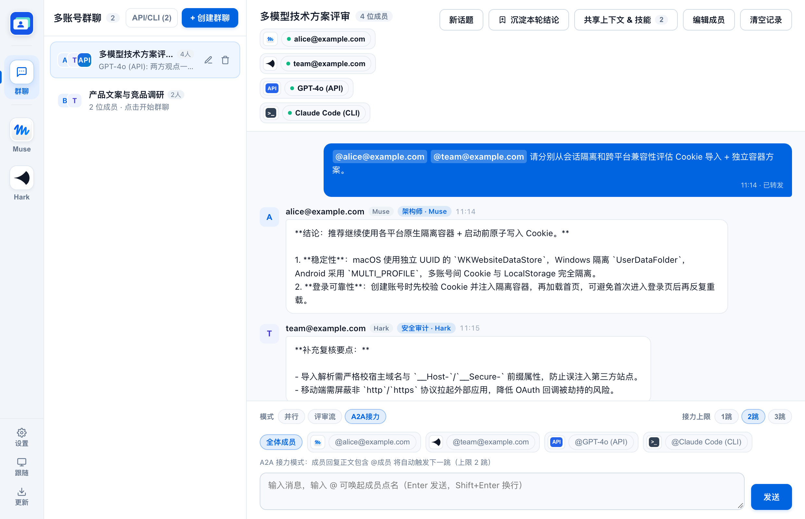
  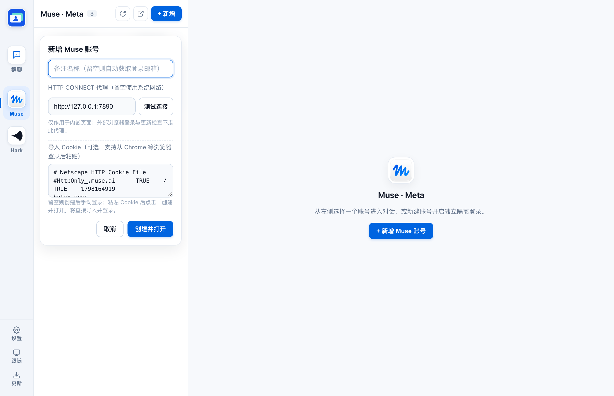
  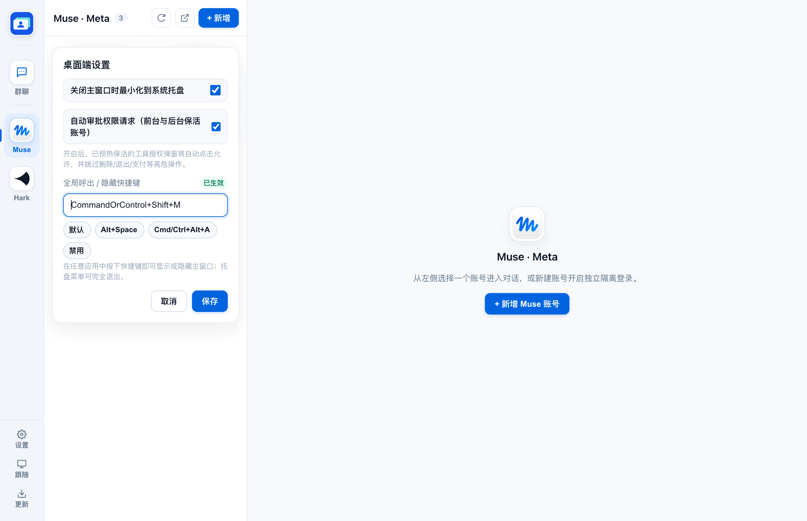
</p>

### macOS

<p align="center">
  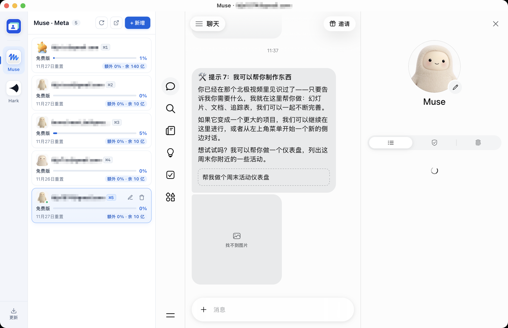
  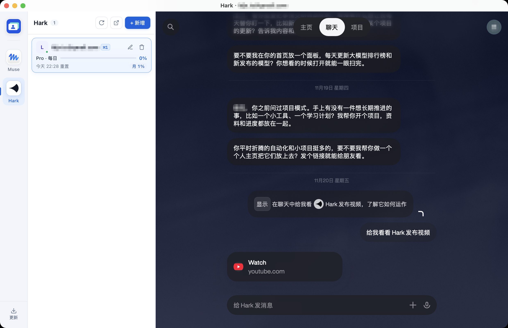
</p>

### Windows

<p align="center">
  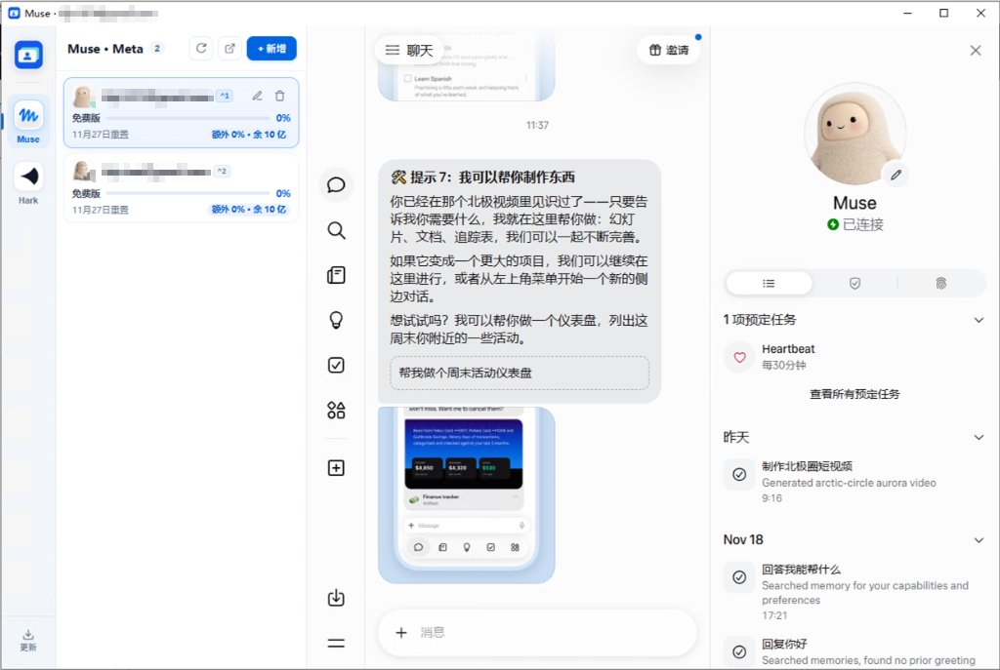
  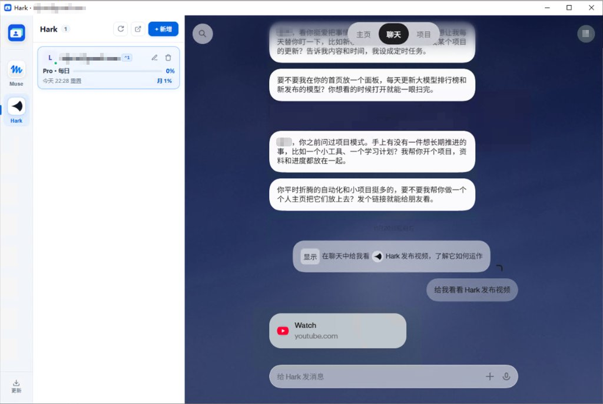
</p>

### Android

<p align="center">
  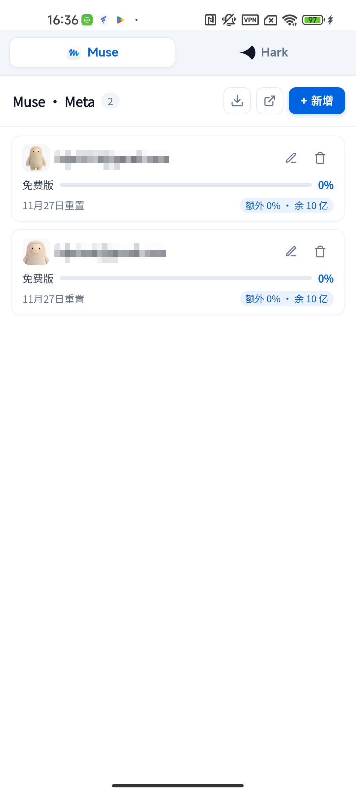
  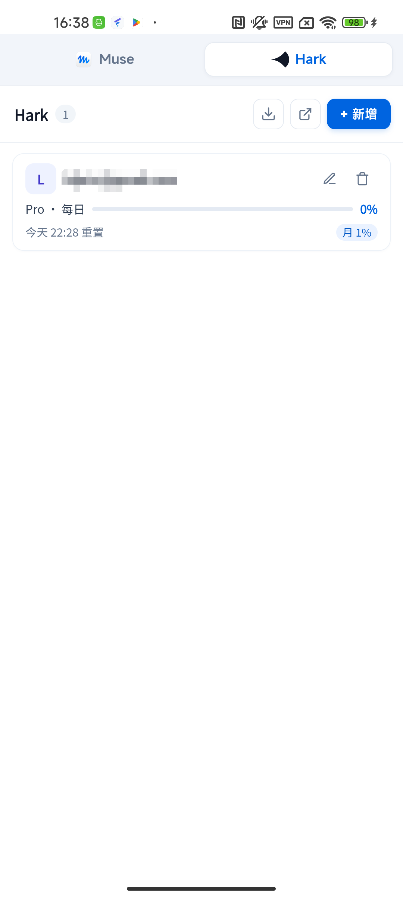
  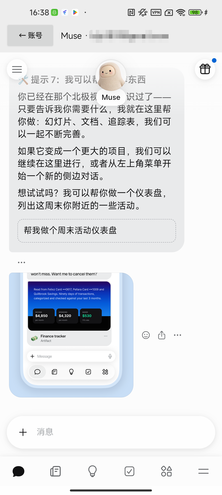
  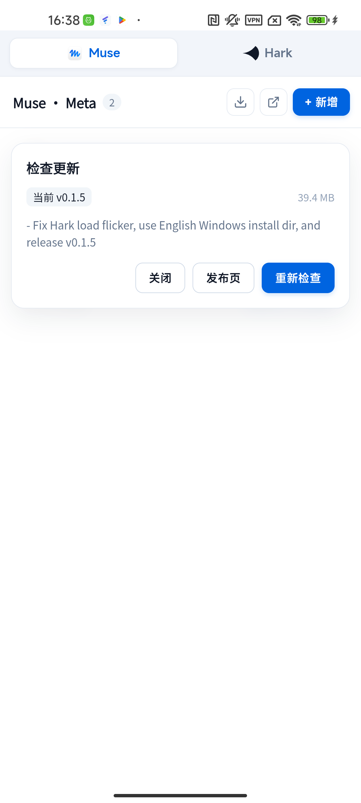
</p>

---

## Download & Installation

Visit [GitHub Releases](https://github.com/ldjx7/multi-agent-account-manager/releases) to download the installer for your platform:

| Platform | Download File | Architecture / System Requirements |
| --- | --- | --- |
| macOS | `account-manager-macos-universal.dmg` | Apple Silicon & Intel (macOS 14.0+) |
| Windows | `account-manager-windows-x64-setup.exe` | x64 (Windows 10 / 11) |
| Android | `account-manager-android-universal-release.apk` | Universal ABI (Android 7.0+) |
| iOS | `account-manager-ios-unsigned.ipa` | Unsigned arm64 package (iOS 17.0+; requires self-signing) |

> `account-manager-macos-universal.app.tar.gz` is used only for in-app macOS updates. For a first-time installation, download the `.dmg` file.

### macOS Installation Notes

1. **Move the app into the Applications folder**: After opening `account-manager-macos-universal.dmg`, be sure to drag `叠号.app` into `/Applications` before launching it. Do not run the app directly from the mounted DMG image. Otherwise, the app cannot replace itself during an update, and the in-app updater will instead ask you to manually replace it from the extracted directory.
2. **“叠号 is damaged and can't be opened” or “Unable to verify developer”**:
   - Because the app is not signed and notarized with a paid Apple Developer certificate, macOS Gatekeeper may attach the `com.apple.quarantine` attribute to browser-downloaded apps, triggering the “damaged” warning.
   - **Method 1 (recommended — remove the quarantine attribute in Terminal)**:
   
     ```bash
     xattr -rd com.apple.quarantine /Applications/叠号.app
     ```

     If you receive a permissions error, run:

     ```bash
     sudo xattr -rd com.apple.quarantine /Applications/叠号.app
     ```

   - **Method 2 (allow it in System Settings)**: Click **Cancel** once, then open **System Settings → Privacy & Security**. Find the blocked-app notice near the bottom of the page and click **Open Anyway**.
   - If opening the `.dmg` file itself triggers a warning, run `xattr -d com.apple.quarantine ~/Downloads/account-manager-macos-universal.dmg` on the DMG file in Terminal first.
3. **Data retention**: Account settings are stored in `~/Library/Application Support/com.ldjx.accountmanager/`, and web session data is stored in the system's `WKWebsiteDataStore`. Overwriting an existing installation or updating through the app will not remove signed-in accounts.

### Windows Installation Notes

1. **SmartScreen warning (“Windows protected your PC”)**:
   - Because the installer is not signed with a paid EV/OV code-signing certificate, Microsoft Defender SmartScreen may display a warning the first time you run `account-manager-windows-x64-setup.exe`.
   - Click **More info**, then click **Run anyway** to continue the installation.
2. **False positives from security software and checksum verification**:
   - If antivirus software incorrectly flags the installer, check the official hash in `latest.json` on the Release page under `platforms.windows.sha256`. Compare it with the local installer before allowing it:
   
     ```powershell
     Get-FileHash .\account-manager-windows-x64-setup.exe -Algorithm SHA256
     ```

3. **WebView2 runtime dependency**:
   - The app requires the Microsoft Edge WebView2 Runtime included with Windows. Windows 11 includes it by default. On some stripped-down editions or older Windows 10 installations, install the **Evergreen Standalone Installer (x64)** from the [official Microsoft Edge WebView2 download page](https://developer.microsoft.com/microsoft-edge/webview2/) if the app opens to a blank screen or fails to start.
4. **Installation permissions and data retention**:
   - Installation in a system-protected directory may require UAC approval. Account settings and each account's separate WebView2 data directory are stored in `%APPDATA%\com.ldjx.accountmanager\`. Overwriting the installation or updating through the app will not clear existing sign-in sessions.

### Android Installation Notes

1. **Allow installation from unknown sources**: The first time you install an `.apk` or use the in-app updater, Android will ask you to grant the **Allow installation of unknown apps** permission. Grant it and return to the installer to proceed with the update.
2. **WebView engine requirement**: Multi-account isolation relies on the `MULTI_PROFILE` capability in Android System WebView. If the app reports that it is unsupported, update Android System WebView (or Chrome) through the app store or system update.
3. **Consistent signing**: All Release APKs are signed with a fixed release key. They can be installed over previous versions while preserving all account sessions.

### iOS Installation Notes

1. **Self-signing**: `account-manager-ios-unsigned.ipa` is an unsigned build. Use **Sideloadly / SideStore / AltStore** with your personal Apple ID to sign and install it on an iPhone (iOS 17.0+).
2. **Trust the certificate on first launch**: If you see an “Untrusted Developer” warning, open **Settings → General → VPN & Device Management** and trust the corresponding developer certificate. On iOS 16+, if Developer Mode is requested, go to **Settings → Privacy & Security → Developer Mode**, enable it, and restart the device.
3. **7-day signing renewal and data retention**: A free personal Apple ID signature is valid for 7 days. Before it expires, re-sign/renew the app in place using the same tool and account to preserve local accounts and sign-in sessions. SideStore can also renew wirelessly.
4. **Permissions**: When using direct QR transfer, grant **Camera** and **Local Network** permissions when prompted.

---

## In-App Updates & Releases

- **Check for updates in the client**: On desktop, click **Update** at the bottom of the left sidebar. On Android, tap the download icon in the top-right corner. The app checks for the latest version and can download, verify, and install it. It also performs a silent check on startup and displays a notification dot when an update is available.
- **Maintainer release process**:
  1. Update the application version in `package.json`, `package-lock.json`, `src-tauri/Cargo.toml`, `src-tauri/Cargo.lock`, and `src-tauri/tauri.conf.json`.
  2. Commit and push a `v*` tag. GitHub Actions will automatically build installers for all four platforms (macOS / Windows / Android / iOS), generate `latest.json`, and create a Release:

     ```bash
     git tag v0.2.0
     git push origin v0.2.0
     ```

---

## Local Development

Requirements: Node.js 22+, Rust 1.85+; Android builds require Android SDK and NDK 26+; iOS builds require Xcode on macOS.

```bash
npm ci
npm run build
node --test relay-worker/test/*.test.js
npm run tauri -- dev
npm run tauri -- build
bash scripts/build-ios-ipa.sh
cd relay-worker && npx wrangler deploy
```

---

## Community & License

This project is part of and acknowledges the open-source [LINUX DO](https://linux.do/) community.

This project is open source under the [Apache-2.0](LICENSE) license.
